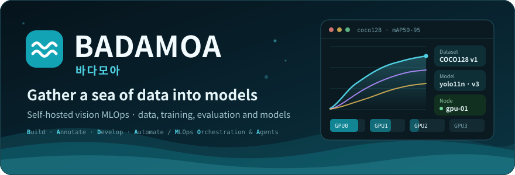
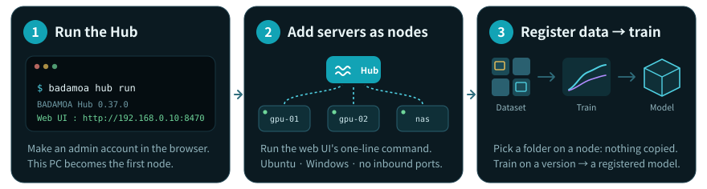
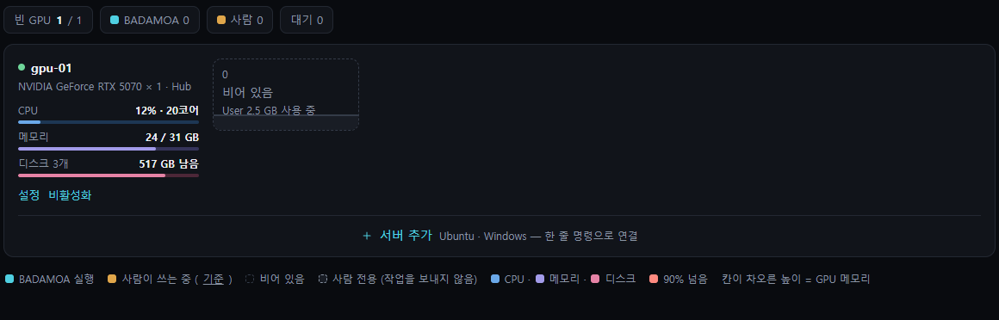
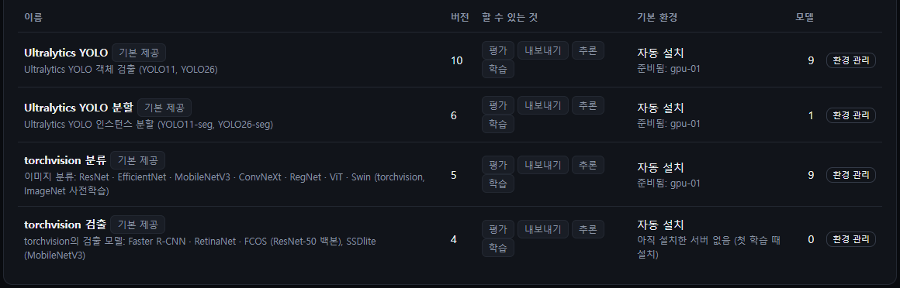

<h1 align="center">
  
</h1>

<p align="center">
  <a href="README.md">한국어</a> &nbsp;|&nbsp; <b>English</b>
</p>

<p align="center">
  <b>A vision MLOps platform you install on your own servers</b><br>
  Data, training, evaluation and model management in one place
</p>

<p align="center">
  🗂️ Dataset catalog without copying &nbsp;·&nbsp; 🏋️ YOLO · torchvision training &nbsp;·&nbsp; 📈 Metric comparison · sweeps<br>
  📦 Model registry &nbsp;·&nbsp; 🖥️ One-line GPU server join &nbsp;·&nbsp; 🤖 MCP agents &nbsp;·&nbsp; 🐳 No Docker
</p>

<br>

<p align="center">
  <a href="#-quick-start"></a>
  &nbsp;&nbsp;
  <a href="https://github.com/RiceShrimp/BADAMOA/releases"></a>
</p>

<p align="center">
  🐧 Ubuntu · ⊞ Windows (Hub and nodes) &nbsp;|&nbsp; 🐍 Python 3.11+ · <a href="https://docs.astral.sh/uv/">uv</a> &nbsp;|&nbsp; 🎮 NVIDIA GPU recommended (CPU works)<br>
  <a href="docs/ARCHITECTURE.md">Design</a> · <a href="docs/ROADMAP.md">Roadmap</a> · <a href="CHANGELOG.md">CHANGELOG</a> &nbsp;<sub>(docs are in Korean)</sub>
</p>

<br>

> **BADA** — **B**uild · **A**nnotate · **D**evelop · **A**utomate &nbsp;/&nbsp; **MOA** — **M**LOps **O**rchestration & **A**gents &nbsp;(*bada moa*: "gather the sea" in Korean)
>
> The goal: manage data, train, evaluate and keep models in one place, attach remote training and data servers with a one-line command, and let agents such as Claude Code drive all of it over MCP.

> 🌐 **The app's screens are in Korean.** Below, buttons are named in English with the on-screen label next to them, e.g. **Nodes** (`노드`).

<br>

## 🚀 Quick start

<p align="center">
  
</p>

| | Step | How |
|:-:|---|---|
| 1️⃣ | **Run the Hub** | The four commands below. When the browser opens, create the admin account. The PC running the Hub becomes the first node |
| 2️⃣ | **Add servers as nodes** | Web UI **Nodes** (`노드`) → **Add node** (`노드 추가`), then run the one-line command on the remote server (Ubuntu · Windows) |
| 3️⃣ | **Register data → train** | **Datasets** (`데이터셋`) → **Import dataset** (`데이터셋 가져오기`), pick a folder on a node → **Train on this version** (`이 버전으로 학습`) |

You need [uv](https://docs.astral.sh/uv/) and Node.js. Run these in order from the repository folder.

```bash
uv sync --all-extras
```

```bash
npm --prefix web install
```

```bash
npm --prefix web run build
```

```bash
uv run badamoa hub run --home .badamoa/hub
```

The browser opens at this PC's network address (e.g. `http://192.168.0.10:8470`, the "웹 UI" line of the start-up message). Other servers join through that address, so use it rather than `localhost`.

> 💡 **Nodes only make outgoing connections to the Hub.** Nothing has to be opened on the remote servers. The only exception is TCP 8475, used when nodes send images straight to each other, which the node installer opens itself.

> 🧪 **Data to try it with**
>
> - `uv run python scripts/fetch_coco128.py` — COCO128 (128 images · about 7 MB)
> - `uv run python scripts/fetch_mnist160.py` — MNIST160 (160 images · about 70 KB)
>
> Both unpack under `.badamoa/data/`.

<br>

## 🗂️ From data to models on one screen

<p align="center">
  
</p>

| | | |
|:-:|---|---|
| 🗂️ | **Registered in place** | Pick a YOLO, COCO or class-per-folder dataset on a node with **Browse** (`찾아보기`). Images stay where they are; the Hub keeps the list and the labels. Detection · segmentation · keypoints · classification |
| 🏷️ | **Versions** | Every import makes a version, with label revision history, statistics, and the difference between two versions |
| 🏆 | **Model ranking** | When a run finishes, its weights become a model version, ranked on the project page by each task's own metric |

<br>

## ✨ Features at a glance

All real screens, from runs on COCO128 and MNIST160. Click an image to see it full size.

<table>
  <tr>
    <td align="center" valign="top" width="50%">
      <br>
      
      <h3>🖼️ Images and labels</h3>
      <p>A grid with boxes, outlines and keypoints drawn.<br>Filter by split, class and label state.</p>
    </td>
    <td align="center" valign="top" width="50%">
      <br>
      
      <h3>📈 Training runs</h3>
      <p>Metric curves, per-epoch prediction images and output files, live.<br>Tick runs in the list to overlay their curves.</p>
    </td>
  </tr>
  <tr>
    <td align="center" valign="top">
      <br>
      
      <h3>🎯 Hyperparameter sweeps</h3>
      <p>Grid · random · Bayesian (Optuna TPE).<br>The best settings and the metric per setting at a glance.</p>
    </td>
    <td align="center" valign="top">
      <br>
      
      <h3>📦 Model versions · evaluation · export</h3>
      <p>Aliases (champion · production …), evaluate on the same data to compare.<br>Export to ONNX · TorchScript, test on images right away.</p>
    </td>
  </tr>
  <tr>
    <td align="center" valign="top">
      <br>
      
      <h3>🖥️ GPU node board</h3>
      <p>GPU tiles plus CPU · memory · disk for each server.<br>GPUs in use by people are left alone; jobs go to free ones.</p>
    </td>
    <td align="center" valign="top">
      <br>
      
      <h3>🔗 Lineage</h3>
      <p>Version → run → model → evaluation · export · test.<br>Trace back which data and settings made a model.</p>
    </td>
  </tr>
  <tr>
    <td align="center" valign="top">
      <br>
      
      <h3>🧩 Your own training code, same screens</h3>
      <p>Add one declaration file to your training code folder,<br>upload it, and it appears as a model type in the training dialog.</p>
    </td>
    <td align="center" valign="top">
      <br>
      
      <h3>🏠 The Hub at a glance</h3>
      <p>Counts of data, models, nodes and storage,<br>and a getting-started list for first-time users.</p>
    </td>
  </tr>
</table>

<br>

## 🏋️ What you can train

| Task | Built-in model types | Evaluate · export · test |
|---|---|---|
| 🎯 **Detection** | Ultralytics YOLO11 · YOLO26<br>torchvision Faster R-CNN · RetinaNet · FCOS · SSDlite | mAP · ONNX · TorchScript · images with boxes |
| 🧩 **Segmentation** | Ultralytics YOLO11-seg · YOLO26-seg | mask mAP · ONNX · images with masks |
| 🔢 **Classification** | torchvision ResNet · EfficientNet · MobileNetV3<br>ConvNeXt · RegNet · ViT · Swin | Top-1/5 · confusion matrix · ONNX · top-5 classes |
| 🦴 **Keypoints** | Import and view only (training planned) | — |
| 🏢 **Your own code** | Anything registered as a [model template](#-registering-your-own-training-code-model-templates) | The template's `eval` · `export` · `predict` |

- **Where a run trains** is automatic (a node that has the images) or your pick. Choose a node without the images and it first fetches them **straight from the node that has them, not through the Hub**.

- The first time a node trains, it installs PyTorch and the training libraries in a separate virtual environment (a few minutes), choosing the build that fits its GPU driver.

- Images, files and checkpoints left by training and evaluation all end up **on the Hub**. If a training server goes away, the results and the checkpoints to resume from stay.

<br>

## 🖥️ Adding remote servers as nodes

1. Web UI → **Nodes** (`노드`) → **Add node** (`노드 추가`) shows a one-line command for Ubuntu and for Windows.

2. Run it on the remote server (`sudo` on Ubuntu, an administrator PowerShell on Windows). It registers to start automatically, so the node comes back after a reboot.

3. Once the server shows up on the node board, you are done. From then on the node updates itself to follow the Hub's version.

> If you started the Hub from this repository with `uv`, it builds the package nodes download (a wheel) by itself. Otherwise run `uv build --wheel -o .badamoa/dist`, then `uv run badamoa hub publish-wheel <wheel file> --home .badamoa/hub`.

<br>

## 🤖 Connecting an agent (MCP)

Web UI → **Agents** (`에이전트`): issue a token and the connect command appears.

```bash
claude mcp add --transport http badamoa http://192.168.0.10:8470/mcp --header "Authorization: Bearer <token>"
```

Then ask things like "check the BADAMOA nodes" or "train yolo11n on coco128 v1 and tell me the metrics when it is done".

| | What an agent can do |
|:-:|---|
| 🖥️ | List and inspect nodes, the GPU board, resource history; make a node join command |
| 🗂️ | Look up projects, datasets and versions, compare versions, import datasets |
| 🏋️ | Start and inspect runs, start and stop sweeps, notes and tags |
| 📦 | Look up models, their lineage, set aliases |
| 🩺 | Run, wait for, read logs of and cancel jobs; "diagnose a failed job" and "node health report" prompts |

<br>

## 🧩 Registering your own training code (model templates)

Put your training code in one folder and add a declaration file (`badamoa.toml`): it shows up as a model type in the training dialog.

```bash
badamoa template init my-model
```

Replace the marked part of `my-model/train.py` with your code. Settings and progress go through the SDK (`badamoa_sdk`). It looks like W&B or MLflow, and BADAMOA makes it importable when it runs your code, so there is nothing to install.

```python
import badamoa_sdk as bm

hp = bm.params(                                  # declared settings → input fields in the training dialog
    model=bm.choice(["resnet18", "resnet50"], label="Model"),
    epochs=bm.integer(30, min=1, label="epoch"),
    lr=bm.number(0.001, label="Learning rate", group="Optimizer", advanced=True),  # folded under "advanced"
)
run = bm.init()                                  # run.data, run.out, run.device, run.classes …
for epoch in range(1, hp.epochs + 1):
    ...
    bm.log({"train_loss": loss, "map50_95": score}, step=epoch)       # charts update right away
    bm.progress(epoch, hp.epochs)
bm.log_artifact("confusion.png")                 # (optional) images and files → the run's "files"
bm.log_model(run.out / "best.pt")                # the weights to register as a model
bm.finish({"map50_95": best})
```

```bash
badamoa template check my-model
```

```bash
badamoa template push my-model --hub http://<hub>:8470 --token <admin API token>
```

<details>
<summary>📋 <b>More on templates</b> — packages, existing environments, input fields, versions</summary>

<br>

- List the packages you need under `[environment] requirements` in `badamoa.toml` and servers install them. To use a conda or venv environment a server already has, register it in Web UI → **Settings** (`설정`) → **Environments** (`환경`) and put its name in `default`.

- What you declare in `bm.params(...)` becomes the training dialog's input fields. `advanced=True` folds a field under the advanced settings, and `group` titles a group there. BADAMOA reads the code rather than running it to build the fields, so values must be written literally. You can also put them under `[params]` in `badamoa.toml` without touching the code.

- Per-step images and tables: `bm.log_image(key=, step=)` · `bm.log_table`. There are callbacks for Lightning and the Hugging Face Trainer too.

- Raise `version` when you upload changed code. Runs record the version they used, so "run again" uses the same code.

</details>

<br>

## ⚠️ Good to know

- 🚧 **Still in development (0.x).** The `P2`–`P5` menu items (sample library · autolabel · review · deploy · pipelines) are not there yet. The order is in the [roadmap](docs/ROADMAP.md).

- 🔓 **HTTP only** (TLS is planned). Use it inside your own network.

- 💾 **Each node gets a virtual environment for training.** With PyTorch in it, plan for a few GB of disk per node.

- 🧪 **Verified on small data** (COCO128 · MNIST160, the smallest YOLO). Speed on large datasets is measured when real ones come in.

<br>

## 📚 More

Folded below. Click a title to open it.

<details>
<summary>🗂️ <b>Registering a dataset</b> — COCO128, MNIST160, real-data tests</summary>

<br>

In Web UI → **Datasets** (`데이터셋`), create a project, press **Import dataset** (`데이터셋 가져오기`) and pick a YOLO or COCO folder on a node (**Browse** shows folders on remote servers too). Images are not copied; they stay where they are.

For something to try, take COCO128 (128 images from COCO, about 7 MB). It unpacks to `.badamoa/data/coco128`.

```bash
uv run python scripts/fetch_coco128.py
```

With it on disk, `uv run pytest` also runs the real-data checks (`tests/test_real_data.py`).

Classification data in class-per-folder form registers the same way (choose the task when importing, or let the folder layout tell). MNIST160 (160 digits, about 70 KB) is there to try:

```bash
uv run python scripts/fetch_mnist160.py
```

</details>

<details>
<summary>🏋️ <b>Training</b> — new runs, GPU assignment, PyTorch builds, a real YOLO test</summary>

<br>

In Web UI → **Training** (`학습`) → **New run** (`새 학습`), pick a dataset version and a model (e.g. yolo11n). **Train on this version** (`이 버전으로 학습`) on a version's page starts one too.

- By default a run trains on a node that has the version's images. Choosing another node under "nodes to train on" first moves the images to it directly (TCP 8475).

- The first time a node trains, it installs PyTorch and Ultralytics in a separate virtual environment (a few minutes; the node needs uv). The PyTorch build is chosen to fit the GPU driver; set `BADAMOA_TORCH_BACKEND` on the node (e.g. `cpu`, `cu128`) to pick one yourself.

- When it finishes, the weights are registered as a version on the **Models** (`모델`) page.

- A GPU on which another process uses more than 10% of the memory counts as busy and jobs wait. To assign anyway on a PC you use alone, start the Hub with `--gpu-busy-memory-pct 101 --gpu-busy-util-pct 101`.

With COCO128 present, a test can run a real YOLO training (1 epoch, CPU):

```bash
BADAMOA_TEST_YOLO=1 uv run pytest tests/test_real_data.py -k yolo
```

</details>

<details>
<summary>🛠️ <b>Development</b> — tests, lint, web UI dev server, layout</summary>

<br>

```bash
uv run pytest
```

```bash
uv run ruff check .
```

When working on the web UI, keep a Hub running and start `npm --prefix web run dev`: `/api` requests are proxied to the Hub.

```
src/badamoa/core       shared schemas · storage · system info
src/badamoa/hub        Hub: REST · node protocol · MCP · web UI hosting
src/badamoa/node       Node Agent · dataset import · training formats · environments · node-to-node transfer
src/badamoa/templates  built-in model templates (YOLO, YOLO-seg, torchvision detection · classification) · SDK (badamoa_sdk) · new-template skeleton
web/                   web UI (React + Vite)
tests/                 unit · API · E2E
```

To ship a version, raise the version in `src/badamoa/__init__.py` together with [CHANGELOG.md](CHANGELOG.md) and push to main: a release with the same notes appears on [GitHub Releases](https://github.com/RiceShrimp/BADAMOA/releases) by itself.

</details>

<details>
<summary>📄 <b>Documents</b> (in Korean) — design, roadmap, plans, screens</summary>

<br>

| Document | About |
|---|---|
| [CHANGELOG.md](CHANGELOG.md) | What changed in each version (same as the in-app release notes and GitHub Releases) |
| [docs/ARCHITECTURE.md](docs/ARCHITECTURE.md) | Goals · design principles · structure · install and operation |
| [docs/ROADMAP.md](docs/ROADMAP.md) | Phases and checklists |
| [docs/EXECUTION_PLAN.md](docs/EXECUTION_PLAN.md) | Plan for in-house training code, environments and storage; MLflow · W&B comparison |
| [docs/LABELING_PLAN.md](docs/LABELING_PLAN.md) | Fixing labels and labeling inside BADAMOA |
| [docs/SCREEN_SPECS.md](docs/SCREEN_SPECS.md) | Screen layouts |
| [docs/REFERENCE_STUDY.md](docs/REFERENCE_STUDY.md) | Study of reference products |
| [docs/PLANS.md](docs/PLANS.md) | The first sketch |

</details>
