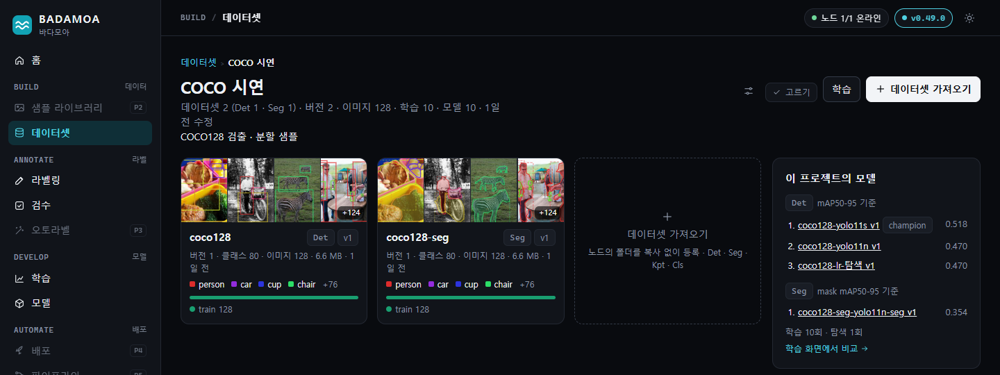
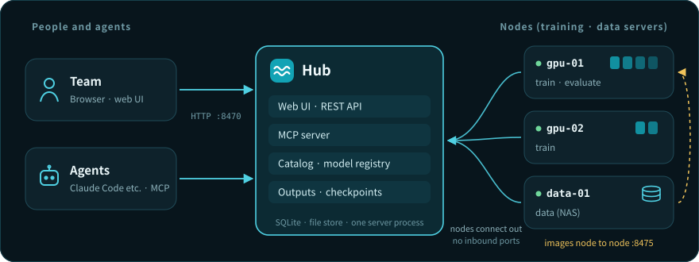
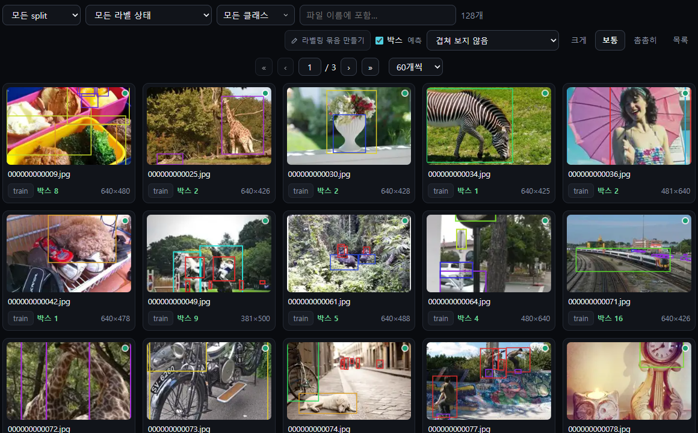
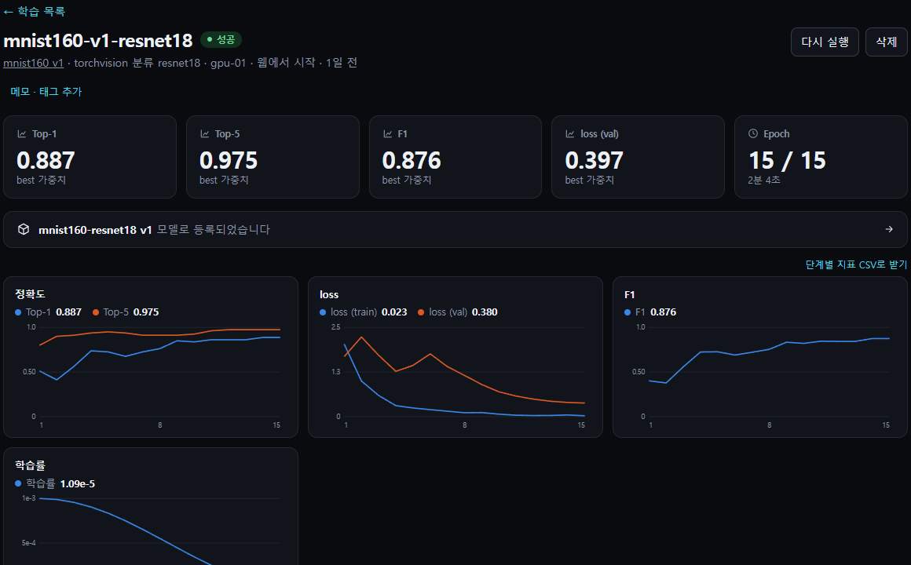
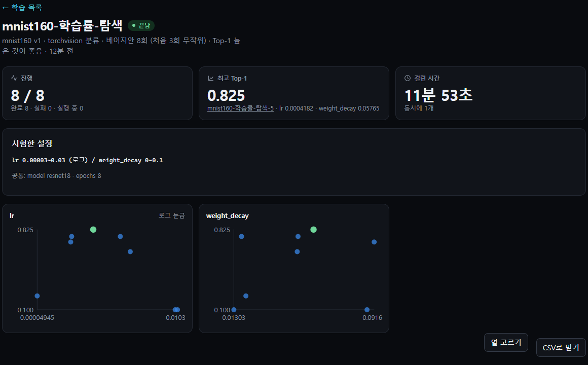
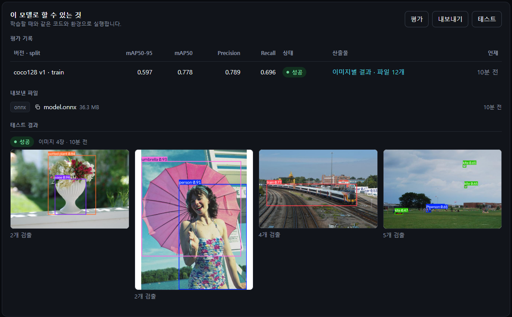
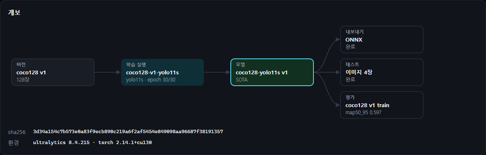
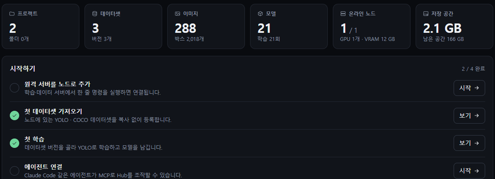

<p align="center">
  
</p>

<p align="center">
  <a href="https://github.com/RiceShrimp/BADAMOA/releases"></a>
  <a href="https://github.com/RiceShrimp/BADAMOA/actions/workflows/ci.yml"></a>
  
  
</p>

<p align="center">
  <a href="README.md">한국어</a> · <b>English</b>
</p>

<br>

**BADAMOA** is a vision MLOps platform you install on your own servers. Registering image datasets, training on the team's GPU servers, and evaluating and keeping the resulting models all happen in one web app. It runs as a single Python package, with no Docker and no extra server software.

The name is Korean for "gathering the sea": collecting a scattered sea of data into models. It also spells **B**uild · **A**nnotate · **D**evelop · **A**utomate and **M**LOps **O**rchestration & **A**gents.

<p align="center">
  
</p>

- **Data stays where it is.** Pick a folder on a training server or a NAS and only the file list and labels go to the Hub. Hundreds of GB never move.

- **GPU servers join with one command.** They only connect out to the Hub, so no firewall holes, and GPUs someone is already using are left alone.

- **Results live on the Hub.** Metrics, images, checkpoints and weights are kept there, so runs can be resumed and compared even after a training server changes.

- **Agents can drive it.** The Hub doubles as an MCP server: hand a training run to an agent such as Claude Code and ask it about the results.

> [!NOTE]
> The app's screens are in Korean. Below, menu and button names are given in English with the on-screen label in parentheses, e.g. **Nodes** (노드).

<br>

## How it fits together

<p align="center">
  
</p>

The Hub serves the web app, the API and the MCP server, and holds the catalog and the model registry, all in one process. Nodes do the actual training and data reading. The PC running the Hub is a node from the start, so a single server is enough to begin with.

<br>

## Installation

### Start the Hub

You need [uv](https://docs.astral.sh/uv/) and Node.js. Run these in order from the repository folder.

```bash
uv sync --all-extras
```

```bash
npm --prefix web install
```

```bash
npm --prefix web run build
```

```bash
uv run badamoa hub run --home .badamoa/hub
```

When the browser opens at this PC's network address (e.g. `http://192.168.0.10:8470`), create the admin account. Other servers find the Hub through that address, so use it rather than `localhost`.

> [!TIP]
> For data to try, `uv run python scripts/fetch_coco128.py` (COCO128, about 7 MB) and `uv run python scripts/fetch_mnist160.py` (MNIST160, about 70 KB). Both unpack under `.badamoa/data/`.

### Add training and data servers

In the web app, **Nodes** (노드) → **Add node** (노드 추가) shows a one-line command for Ubuntu and one for Windows. Run it on the server (`sudo` on Ubuntu, an administrator PowerShell on Windows): it registers to start automatically and shows up on the node board shortly after. From then on the node updates itself to follow the Hub's version.

Only node-to-node image transfers use TCP 8475, and the install command opens it in the firewall.

<details>
<summary>If the Hub was not started from this repository</summary>

<br>

Started from the repository with `uv`, the Hub builds the package nodes download (a wheel) by itself. Otherwise build and upload it yourself:

```bash
uv build --wheel -o .badamoa/dist
```

```bash
uv run badamoa hub publish-wheel <wheel file> --home .badamoa/hub
```

</details>

### Connect an agent (MCP)

On the **Agents** (에이전트) page, issue a token and the connect command appears.

```bash
claude mcp add --transport http badamoa http://192.168.0.10:8470/mcp --header "Authorization: Bearer <token>"
```

Then just ask: "check the nodes", "train yolo11n on coco128 v1 and tell me the metrics when it's done". Agents can see nodes and GPUs, datasets and versions, start runs and hyperparameter sweeps, look up models and their lineage, set aliases, and read job logs to diagnose failures.

<br>

## A tour

Everything below is a real screen, taken from a Hub that has trained on COCO128 and MNIST160.

### Datasets

<p align="center">
  
</p>

YOLO, COCO and class-per-folder layouts are read as they are and registered as detection, segmentation, keypoint or classification datasets. Every import makes a version, and versions can be compared. Images can be filtered by split, class and label state. Wrong boxes or classes are fixed right where you see them, and the fixes are confirmed together as a new version; existing versions never change.

### Training and hyperparameter sweeps

<p align="center">
  
  
</p>

Pick a dataset version and a model and the run goes to a node with a free GPU; metric curves and per-epoch prediction images come in live. Overlay runs to compare their curves, and resume a stopped run from its checkpoint. Sweeps can be grid, random or Bayesian (Optuna TPE).

### Models

<p align="center">
  
</p>

A finished run's weights become a model version. Give it aliases such as champion or production, evaluate models on the same data to compare them, export to ONNX or TorchScript, and upload images to test it on the spot. Its lineage traces back which data and settings produced it.

<p align="center">
  
</p>

### Servers and the Hub

<p align="center">
  
  
</p>

The node board shows each server's GPUs alongside its CPU, memory and disk. A GPU someone is using directly counts as busy and gets no jobs. Home sums up data, models, nodes and storage at a glance.

<br>

## Supported models

| Task | Built in | Evaluate · export · test |
|---|---|---|
| Detection | Ultralytics YOLO11 · YOLO26<br>torchvision Faster R-CNN · RetinaNet · FCOS · SSDlite | mAP, ONNX · TorchScript, images with boxes |
| Segmentation | Ultralytics YOLO11-seg · YOLO26-seg | mask mAP, ONNX, images with masks |
| Classification | torchvision ResNet · EfficientNet · MobileNetV3<br>ConvNeXt · RegNet · ViT · Swin | Top-1 · Top-5, confusion matrix, ONNX |
| Keypoints | Import and view only (training planned) | — |

The first time a node trains, it installs PyTorch and the training libraries in a separate virtual environment on that node (a few minutes). The build is chosen to fit the GPU driver; set `BADAMOA_TORCH_BACKEND` on the node (e.g. `cpu`, `cu128`) to pick one yourself.

<br>

## Bringing your own training code

To use your team's training code instead of the built-in models, put it in one folder, add a declaration file (`badamoa.toml`) and upload it as a **model template**. It then appears as a model type on the training page and trains, evaluates and exports like the built-in ones.

<p align="center">
  
</p>

```bash
badamoa template init my-model
```

Replace the marked part of `my-model/train.py` with your code. Settings and progress go through the SDK (`badamoa_sdk`), which looks much like W&B or MLflow. BADAMOA provides the SDK when it runs your code, so there is nothing to install.

```python
import badamoa_sdk as bm

hp = bm.params(                                  # declared settings → input fields on the training page
    model=bm.choice(["resnet18", "resnet50"], label="Model"),
    epochs=bm.integer(30, min=1, label="epoch"),
    lr=bm.number(0.001, label="Learning rate", group="Optimizer", advanced=True),  # folded under advanced settings
)
run = bm.init()                                  # run.data, run.out, run.device, run.classes …
for epoch in range(1, hp.epochs + 1):
    ...
    bm.log({"train_loss": loss, "map50_95": score}, step=epoch)       # charts update right away
    bm.progress(epoch, hp.epochs)
bm.log_artifact("confusion.png")                 # (optional) images and files → the run's files
bm.log_model(run.out / "best.pt")                # the weights to register as a model
bm.finish({"map50_95": best})
```

Check it, then upload it to the Hub:

```bash
badamoa template check my-model
```

```bash
badamoa template push my-model --hub http://<hub>:8470 --token <admin API token>
```

Packages listed under `[environment] requirements` in `badamoa.toml` are installed by the servers. To use a conda or venv environment a server already has, register it under **Settings** (설정) → **Environments** (환경) and put its name in `default`. Raise `version` when you upload changed code; every run remembers the version it used, so "run again" uses the same code.

<br>

## Status

BADAMOA is in 0.x development. Here is what works and what is still to come; the order is in the [roadmap](docs/ROADMAP.md) (in Korean).

| Area | Works | To come |
|---|---|---|
| **Build** · data | ✅ Registering in place, versions and label revisions, version diff, node-to-node transfer | 🚧 Sample library, embedding search, curation |
| **Annotate** · labels | ✅ Viewing boxes, outlines and keypoints; fixing labels in place and confirming them as a version | 🚧 Editing outline and keypoint shapes, autolabel, review |
| **Develop** · training | ✅ Training, sweeps, evaluation, export, model registry, your own templates | 🚧 TensorRT, keypoint training |
| **Automate** · deployment | — | 🚧 Inference service, deployment, pipelines |
| **MOA** · operations | ✅ Nodes and GPU assignment, self-updating nodes, MCP agents | 🚧 Approval gates, built-in agent |

> [!NOTE]
> It speaks plain HTTP for now (TLS is planned), so keep it inside your own network. Each node gets a virtual environment with PyTorch in it, a few GB of disk. It has been verified on small data such as COCO128 and MNIST160; speed on large datasets will be measured as real ones come in.

<br>

## Development

```bash
uv run pytest
```

```bash
uv run ruff check .
```

When working on the web app, keep a Hub running and start `npm --prefix web run dev`: `/api` requests are passed to the Hub. With COCO128 downloaded, `uv run pytest` also runs the real-data checks, and `BADAMOA_TEST_YOLO=1` adds a real YOLO training (1 epoch, CPU).

```
src/badamoa/core       shared schemas · storage · system info
src/badamoa/hub        Hub: REST · node protocol · MCP · serving the web app
src/badamoa/node       Node Agent · dataset import · training formats · environments · node-to-node transfer
src/badamoa/templates  built-in model templates · SDK (badamoa_sdk) · new-template skeleton
web/                   web app (React + Vite)
tests/                 unit · API · E2E
```

To ship a version, raise the version in `src/badamoa/__init__.py` together with [CHANGELOG.md](CHANGELOG.md) and push to main. A release with the same notes appears on [GitHub Releases](https://github.com/RiceShrimp/BADAMOA/releases) by itself.

### Documents (in Korean)

- [CHANGELOG.md](CHANGELOG.md) — changes per version (the same as the in-app release notes)
- [docs/ARCHITECTURE.md](docs/ARCHITECTURE.md) — goals, design principles, structure
- [docs/ROADMAP.md](docs/ROADMAP.md) — phases and checklists
- [docs/EXECUTION_PLAN.md](docs/EXECUTION_PLAN.md) — in-house training code, environments and storage; MLflow · W&B comparison
- [docs/LABELING_PLAN.md](docs/LABELING_PLAN.md) — fixing labels and labeling inside BADAMOA
- [docs/SCREEN_SPECS.md](docs/SCREEN_SPECS.md) — screen layouts
- [docs/REFERENCE_STUDY.md](docs/REFERENCE_STUDY.md) · [docs/PLANS.md](docs/PLANS.md) — study of reference products, the first sketch
