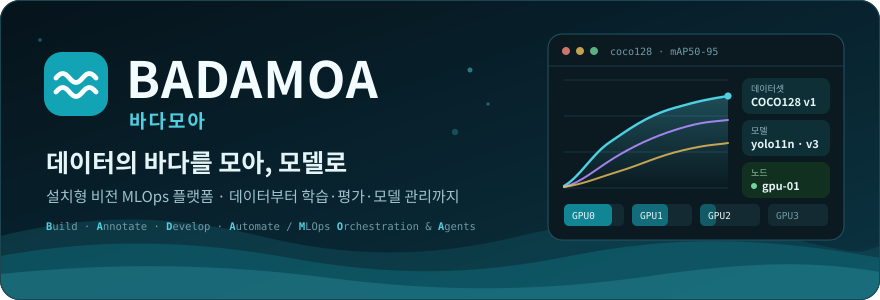
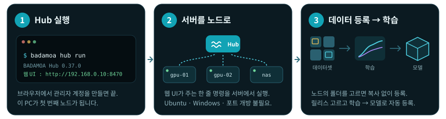
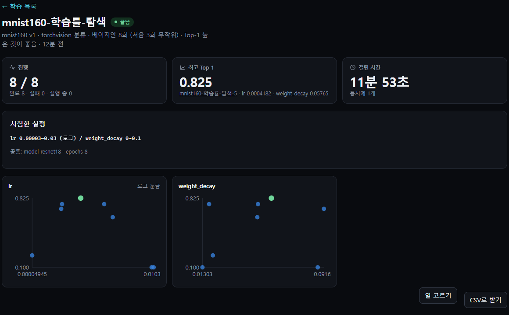
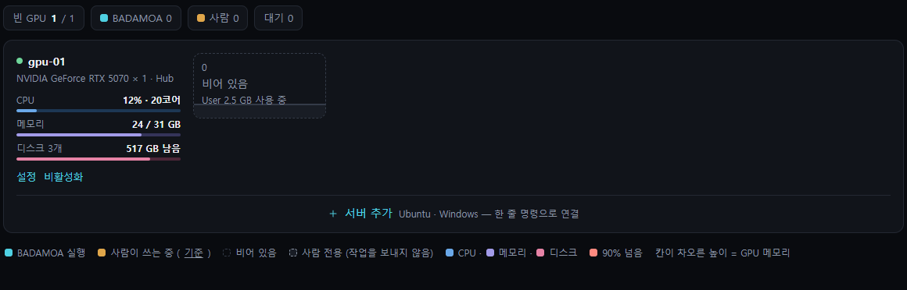
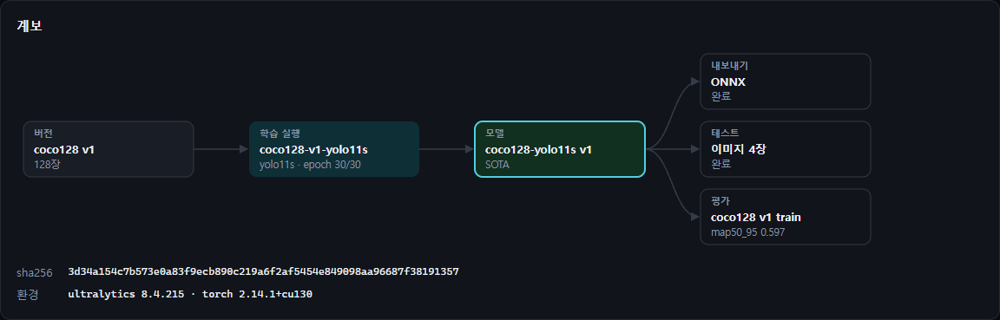
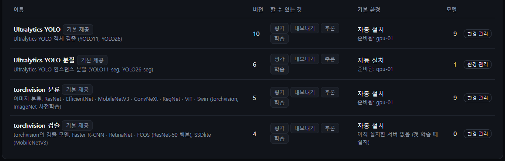

<h1 align="center">
  
</h1>

<p align="center">
  <b>한국어</b> &nbsp;|&nbsp; <a href="README.en.md">English</a>
</p>

<p align="center">
  <b>내 서버에 설치해 쓰는 비전 MLOps 플랫폼</b><br>
  데이터부터 학습 · 평가 · 모델 관리까지 한 곳에서
</p>

<p align="center">
  🗂️ 복사 없는 데이터셋 카탈로그 &nbsp;·&nbsp; 🏋️ YOLO · torchvision 학습 &nbsp;·&nbsp; 📈 지표 비교 · 탐색<br>
  📦 모델 레지스트리 &nbsp;·&nbsp; 🖥️ GPU 서버 한 줄 연결 &nbsp;·&nbsp; 🤖 MCP 에이전트 &nbsp;·&nbsp; 🐳 Docker 없이
</p>

<br>

<p align="center">
  <a href="#-빠른-시작"></a>
  &nbsp;&nbsp;
  <a href="https://github.com/RiceShrimp/BADAMOA/releases"></a>
</p>

<p align="center">
  🐧 Ubuntu · ⊞ Windows (Hub와 노드 모두) &nbsp;|&nbsp; 🐍 Python 3.11+ · <a href="https://docs.astral.sh/uv/">uv</a> &nbsp;|&nbsp; 🎮 NVIDIA GPU 권장 (CPU도 됨)<br>
  <a href="docs/ARCHITECTURE.md">설계</a> · <a href="docs/ROADMAP.md">로드맵</a> · <a href="CHANGELOG.md">CHANGELOG</a>
</p>

<br>

> **BADA** — **B**uild · **A**nnotate · **D**evelop · **A**utomate &nbsp;/&nbsp; **MOA** — **M**LOps **O**rchestration & **A**gents
>
> 데이터 관리, 학습, 평가, 모델 관리를 한 곳에서 하고, 원격 학습·데이터 서버를 한 줄 명령으로 붙이며, Claude Code 같은 에이전트가 MCP로 전부 조작할 수 있게 만드는 것이 목표입니다.

<br>

## 🚀 빠른 시작

<p align="center">
  
</p>

| | 할 일 | 방법 |
|:-:|---|---|
| 1️⃣ | **Hub 실행** | 아래 명령 네 줄. 브라우저가 열리면 관리자 계정을 만듭니다. Hub를 띄운 PC가 첫 번째 노드가 됩니다 |
| 2️⃣ | **서버를 노드로** | 웹 UI `노드` → `노드 추가`에 나오는 한 줄 명령을 원격 서버(Ubuntu · Windows)에서 실행 |
| 3️⃣ | **데이터 등록 → 학습** | `데이터셋` → `데이터셋 가져오기`에서 노드의 폴더 고르기 → 버전 화면의 `이 버전으로 학습` |

[uv](https://docs.astral.sh/uv/)와 Node.js가 필요합니다. 저장소를 받은 폴더에서 차례로 실행하세요.

```bash
uv sync --all-extras
```

```bash
npm --prefix web install
```

```bash
npm --prefix web run build
```

```bash
uv run badamoa hub run --home .badamoa/hub
```

브라우저는 이 PC의 네트워크 주소(예: `http://192.168.0.10:8470`, 시작 메시지의 "웹 UI")로 열립니다. 다른 서버를 노드로 붙일 때 그 주소를 쓰므로 `localhost` 대신 이 주소로 접속하세요.

> 💡 **노드는 Hub로 나가는 연결만 씁니다.** 원격 서버 쪽에 포트를 열 필요가 없습니다. 노드끼리 이미지를 직접 주고받을 때 쓰는 TCP 8475만 노드 설치 스크립트가 엽니다.

> 🧪 **시험해 볼 데이터**
>
> - `uv run python scripts/fetch_coco128.py` — COCO128 (128장 · 약 7 MB)
> - `uv run python scripts/fetch_mnist160.py` — MNIST160 (160장 · 약 70 KB)
>
> `.badamoa/data/` 아래에 풀립니다.

<br>

## 🗂️ 데이터부터 모델까지 한 화면에

<p align="center">
  
</p>

| | | |
|:-:|---|---|
| 🗂️ | **복사 없이 등록** | 노드에 있는 YOLO · COCO · 클래스별 폴더를 `찾아보기`로 고르기만 합니다. 이미지는 제자리에 두고 목록과 라벨만 Hub에 모읍니다. 검출 · 분할 · 키포인트 · 분류 |
| 🏷️ | **버전(릴리스)** | 가져올 때마다 버전이 생깁니다. 라벨 개정 이력, 통계, 두 버전의 차이를 봅니다 |
| 🏆 | **모델 순위** | 학습이 끝나면 가중치가 모델 버전으로 등록되고, 프로젝트 화면에 작업별 지표 순으로 놓입니다 |

<br>

## ✨ 한눈에 보는 기능

모두 실제 화면입니다(COCO128 · MNIST160으로 학습한 예). 그림을 누르면 크게 볼 수 있습니다.

<table>
  <tr>
    <td align="center" valign="top" width="50%">
      <br>
      
      <h3>🖼️ 이미지와 라벨 보기</h3>
      <p>박스 · 윤곽 · 키포인트를 그린 그리드.<br>split · 클래스 · 라벨 상태로 거릅니다.</p>
    </td>
    <td align="center" valign="top" width="50%">
      <br>
      
      <h3>📈 학습 실행 기록</h3>
      <p>지표 곡선, epoch별 예측 그림, 산출물 파일이 실시간으로.<br>실행 목록에서 체크하면 곡선을 겹쳐 비교합니다.</p>
    </td>
  </tr>
  <tr>
    <td align="center" valign="top">
      <br>
      
      <h3>🎯 하이퍼파라미터 탐색</h3>
      <p>모든 조합 · 무작위 · 베이지안(Optuna TPE).<br>가장 좋은 설정과 설정별 지표를 한눈에.</p>
    </td>
    <td align="center" valign="top">
      <br>
      
      <h3>📦 모델 버전 · 평가 · 내보내기</h3>
      <p>alias(champion · production …), 같은 데이터로 평가해 비교.<br>ONNX · TorchScript 내보내기, 이미지로 바로 테스트.</p>
    </td>
  </tr>
  <tr>
    <td align="center" valign="top">
      <br>
      
      <h3>🖥️ GPU 노드 보드</h3>
      <p>서버마다 GPU 칸과 CPU · 메모리 · 디스크.<br>사람이 쓰는 GPU는 피하고 빈 GPU에만 배정합니다.</p>
    </td>
    <td align="center" valign="top">
      <br>
      
      <h3>🔗 계보</h3>
      <p>버전 → 학습 → 모델 → 평가 · 내보내기 · 테스트.<br>이 모델이 어느 데이터로 어떻게 나왔는지 거꾸로 따라갑니다.</p>
    </td>
  </tr>
  <tr>
    <td align="center" valign="top">
      <br>
      
      <h3>🧩 사내 학습 코드도 같은 화면에</h3>
      <p>학습 코드 폴더에 선언 파일 하나를 더해 올리면<br>학습 대화상자의 "모델 종류"에 나옵니다.</p>
    </td>
    <td align="center" valign="top">
      <br>
      
      <h3>🏠 Hub 상태 한눈에</h3>
      <p>데이터 · 모델 · 노드 · 저장 공간 숫자와<br>처음 쓰는 사람을 위한 "시작하기" 목록.</p>
    </td>
  </tr>
</table>

<br>

## 🏋️ 학습할 수 있는 모델

| 작업 | 기본 제공 모델 종류 | 평가 · 내보내기 · 테스트 |
|---|---|---|
| 🎯 **검출** | Ultralytics YOLO11 · YOLO26<br>torchvision Faster R-CNN · RetinaNet · FCOS · SSDlite | mAP · ONNX · TorchScript · 박스 그린 이미지 |
| 🧩 **분할** | Ultralytics YOLO11-seg · YOLO26-seg | mask mAP · ONNX · 마스크 그린 이미지 |
| 🔢 **분류** | torchvision ResNet · EfficientNet · MobileNetV3<br>ConvNeXt · RegNet · ViT · Swin | Top-1/5 · 혼동 행렬 · ONNX · 상위 5개 클래스 |
| 🦴 **키포인트** | 가져오기 · 보기만 (학습은 예정) | — |
| 🏢 **사내 코드** | [모델 템플릿](#-사내-학습-코드-등록하기-모델-템플릿)으로 등록한 무엇이든 | 템플릿의 `eval` · `export` · `predict` |

- **학습할 노드**는 자동(이미지가 있는 노드)이거나 직접 고릅니다. 이미지가 없는 노드를 고르면 그 노드가 이미지가 있는 노드에서 **Hub를 거치지 않고 직접** 받아 둔 뒤 학습합니다.

- 노드가 처음 학습할 때 PyTorch와 학습 라이브러리를 별도 가상환경에 설치합니다(몇 분). GPU 드라이버에 맞는 빌드를 자동으로 고릅니다.

- 학습 · 평가가 남긴 그림, 파일, 체크포인트는 모두 **Hub에** 모입니다. 학습 서버가 사라져도 결과와 이어서 학습할 체크포인트는 남습니다.

<br>

## 🖥️ 원격 서버를 노드로

1. 웹 UI → **노드** → **노드 추가**를 누르면 Ubuntu · Windows용 한 줄 명령이 나옵니다.

2. 원격 서버에서 그 명령을 실행합니다(Ubuntu는 `sudo`, Windows는 관리자 PowerShell). 자동 시작으로 등록되어 재부팅해도 다시 붙습니다.

3. 노드 화면에 서버가 나타나면 끝입니다. 이후 업데이트는 Hub 버전을 따라 노드가 스스로 합니다.

> 저장소에서 `uv`로 Hub를 띄웠다면 노드가 받아 갈 설치 파일(wheel)을 Hub가 알아서 만듭니다. 그렇지 않으면 `uv build --wheel -o .badamoa/dist` 뒤 `uv run badamoa hub publish-wheel <wheel 파일> --home .badamoa/hub`로 올립니다.

<br>

## 🤖 에이전트 연결 (MCP)

웹 UI → **에이전트**에서 토큰을 발급하면 연결 명령이 나옵니다.

```bash
claude mcp add --transport http badamoa http://192.168.0.10:8470/mcp --header "Authorization: Bearer <토큰>"
```

연결한 뒤 "BADAMOA 노드 상태 점검해줘", "coco128 v1으로 yolo11n 학습 돌리고 끝나면 지표 알려줘"처럼 요청하면 됩니다.

| | 에이전트가 할 수 있는 일 |
|:-:|---|
| 🖥️ | 노드 목록 · 상세 · GPU 자리표 · 자원 이력, 노드 추가 명령 만들기 |
| 🗂️ | 프로젝트 · 데이터셋 · 버전 조회, 버전 비교, 데이터셋 가져오기 |
| 🏋️ | 학습 시작 · 조회, 하이퍼파라미터 탐색 시작 · 중단, 메모 · 태그 |
| 📦 | 모델 조회 · 계보 · alias 지정 |
| 🩺 | 작업 실행 · 대기 · 로그 · 취소, "실패한 작업 진단" · "노드 상태 점검" 프롬프트 |

<br>

## 🧩 사내 학습 코드 등록하기 (모델 템플릿)

학습 코드를 폴더 하나로 묶고 선언 파일(`badamoa.toml`)을 더하면, 학습 대화상자의 "모델 종류"에 나옵니다.

```bash
badamoa template init my-model
```

`my-model/train.py`의 표시한 부분을 자신의 코드로 바꿉니다. 설정 선언과 진행 보고는 SDK(`badamoa_sdk`)로 합니다. W&B · MLflow와 비슷한 모양이고, BADAMOA가 실행할 때 자동으로 import할 수 있게 해 주므로 따로 설치하지 않습니다.

```python
import badamoa_sdk as bm

hp = bm.params(                                  # 설정 선언 → 학습 대화상자의 입력 칸
    model=bm.choice(["resnet18", "resnet50"], label="모델"),
    epochs=bm.integer(30, min=1, label="epoch"),
    lr=bm.number(0.001, label="학습률", group="최적화", advanced=True),   # "세부 설정"의 "최적화" 묶음
)
run = bm.init()                                  # run.data, run.out, run.device, run.classes …
for epoch in range(1, hp.epochs + 1):
    ...
    bm.log({"train_loss": loss, "map50_95": score}, step=epoch)       # 화면의 그래프에 바로 반영
    bm.progress(epoch, hp.epochs)
bm.log_artifact("confusion.png")                 # (선택) 그림·파일 → 실행 화면의 "파일"
bm.log_model(run.out / "best.pt")                # 모델로 등록할 가중치
bm.finish({"map50_95": best})
```

```bash
badamoa template check my-model
```

```bash
badamoa template push my-model --hub http://<hub>:8470 --token <관리자 API 토큰>
```

<details>
<summary>📋 <b>템플릿 더 알아보기</b> — 패키지, 기존 환경, 입력 칸, 버전</summary>

<br>

- 필요한 패키지는 `badamoa.toml`의 `[environment] requirements`에 적으면 서버가 자동으로 설치합니다. 서버에 이미 있는 conda · venv 환경을 쓰려면 웹 UI → **설정** → **환경**에서 등록하고 그 이름을 `default`에 적습니다.

- `bm.params(...)`에 선언한 항목이 학습 대화상자의 입력 칸이 됩니다. `advanced=True`는 "세부 설정"에 접히고 `group`은 그 안의 묶음 제목입니다. BADAMOA는 코드를 실행하지 않고 읽어서 입력 칸을 만들므로 값은 직접 적어야 합니다. 코드를 건드리지 않고 `badamoa.toml`의 `[params]`에 적어도 됩니다.

- 단계별 그림 · 표는 `bm.log_image(key=, step=)` · `bm.log_table`, Lightning · Hugging Face Trainer 콜백도 있습니다.

- 코드를 바꿔 다시 올릴 때는 `version`을 올립니다. 학습 실행은 쓴 버전을 기록하므로 "다시 실행"은 같은 코드로 돕니다.

</details>

<br>

## ⚠️ 알아 둘 점

- 🚧 **개발 중(0.x)입니다.** 왼쪽 메뉴의 `P2`~`P5`(샘플 라이브러리 · 오토라벨 · 검수 · 배포 · 파이프라인)는 아직 없습니다. 순서는 [로드맵](docs/ROADMAP.md)에 있습니다.

- 🔓 **HTTP로만 동작합니다**(TLS는 예정). 사내망 안에서 쓰세요.

- 💾 **노드마다 학습용 가상환경을 만듭니다.** PyTorch가 들어가므로 노드 디스크에 수 GB가 필요합니다.

- 🧪 **확인은 작은 데이터로 했습니다**(COCO128 · MNIST160, YOLO 가장 작은 크기). 큰 데이터에서의 속도는 실제로 올릴 때 잽니다.

<br>

## 📚 자세히

아래는 접어 둔 설명서입니다. 제목을 누르면 펼쳐집니다.

<details>
<summary>🗂️ <b>데이터셋 등록해 보기</b> — COCO128, MNIST160, 실데이터 테스트</summary>

<br>

웹 UI → **데이터셋**에서 프로젝트를 만들고 **데이터셋 가져오기**를 누른 뒤, 노드에 있는 YOLO 또는 COCO 형식 폴더를 고릅니다(`찾아보기`로 원격 서버의 폴더도 보입니다). 이미지는 복사하지 않고 제자리에 둡니다.

시험해 볼 데이터가 필요하면 COCO128(COCO에서 뽑은 128장, 약 7 MB)을 받아 쓰면 됩니다. `.badamoa/data/coco128`에 풀립니다.

```bash
uv run python scripts/fetch_coco128.py
```

이 데이터가 있으면 `uv run pytest`가 실데이터 확인 테스트(`tests/test_real_data.py`)도 함께 실행합니다.

분류는 클래스별 폴더로 된 데이터를 같은 방법으로 등록합니다(가져올 때 작업 종류를 고르거나, 폴더 모양으로 알아봅니다). 시험용으로 MNIST160(숫자 160장, 약 70 KB)을 받을 수 있습니다.

```bash
uv run python scripts/fetch_mnist160.py
```

</details>

<details>
<summary>🏋️ <b>학습해 보기</b> — 새 학습, GPU 배정, PyTorch 빌드, 실제 YOLO 테스트</summary>

<br>

웹 UI → **학습** → **새 학습**에서 데이터셋 버전과 모델(예: yolo11n)을 고르면 됩니다. 버전 화면의 **이 버전으로 학습** 버튼으로도 시작할 수 있습니다.

- 학습은 기본으로 그 버전의 이미지가 있는 노드에서 실행됩니다. "학습할 노드"에서 다른 노드를 고르면 이미지를 먼저 그 노드로 직접 옮깁니다(TCP 8475).

- 노드가 처음 학습할 때 PyTorch와 Ultralytics를 별도 가상환경에 설치합니다(몇 분, 노드에 uv 필요). GPU 드라이버에 맞는 PyTorch 빌드를 자동으로 고르며, 노드의 환경 변수 `BADAMOA_TORCH_BACKEND`(예: `cpu`, `cu128`)로 지정할 수도 있습니다.

- 끝나면 가중치가 **모델** 화면에 버전으로 등록됩니다.

- 다른 프로세스가 GPU 메모리를 10% 넘게 쓰고 있으면 그 GPU는 "사용 중"으로 보고 기다립니다. 혼자 쓰는 PC에서 그래도 배정하려면 Hub를 `--gpu-busy-memory-pct 101 --gpu-busy-util-pct 101`로 실행합니다.

COCO128이 있으면 실제 YOLO 학습(1 epoch, CPU)까지 확인하는 테스트를 돌릴 수 있습니다.

```bash
BADAMOA_TEST_YOLO=1 uv run pytest tests/test_real_data.py -k yolo
```

</details>

<details>
<summary>🛠️ <b>개발</b> — 테스트, 린트, 웹 UI 개발 서버, 폴더 구조</summary>

<br>

```bash
uv run pytest
```

```bash
uv run ruff check .
```

웹 UI를 고칠 때는 Hub를 띄운 채로 `npm --prefix web run dev`를 실행하면 `/api` 요청이 Hub로 프록시됩니다.

```
src/badamoa/core       공용 스키마 · storage · 시스템 정보
src/badamoa/hub        Hub: REST · 노드 프로토콜 · MCP · 웹 UI 호스팅
src/badamoa/node       Node Agent · 데이터 가져오기 · 학습용 변환 · 환경 · 노드 간 전송
src/badamoa/templates  내장 모델 템플릿(YOLO, YOLO-seg, torchvision 검출 · 분류) · SDK(badamoa_sdk) · 새 템플릿의 뼈대
web/                   웹 UI (React + Vite)
tests/                 단위 · API · E2E
```

새 버전은 `src/badamoa/__init__.py`의 버전과 [CHANGELOG.md](CHANGELOG.md)를 함께 올려 main에 푸시하면, [GitHub Releases](https://github.com/RiceShrimp/BADAMOA/releases)에 같은 내용의 릴리즈가 자동으로 만들어집니다.

</details>

<details>
<summary>📄 <b>문서</b> — 설계, 로드맵, 계획, 화면 구성</summary>

<br>

| 문서 | 내용 |
|---|---|
| [CHANGELOG.md](CHANGELOG.md) | 버전별로 바뀐 점 (앱 안의 릴리즈 노트, GitHub Releases와 같은 내용) |
| [docs/ARCHITECTURE.md](docs/ARCHITECTURE.md) | 목표 · 설계 원칙 · 구조 · 설치와 운영 |
| [docs/ROADMAP.md](docs/ROADMAP.md) | Phase별 일정과 체크리스트 |
| [docs/EXECUTION_PLAN.md](docs/EXECUTION_PLAN.md) | 사내 학습 코드 등록 · 환경 선택 · 저장 위치 계획, MLflow · W&B 대조표 |
| [docs/LABELING_PLAN.md](docs/LABELING_PLAN.md) | 라벨 고치기 · 라벨링 계획 |
| [docs/SCREEN_SPECS.md](docs/SCREEN_SPECS.md) | 화면 구성 |
| [docs/REFERENCE_STUDY.md](docs/REFERENCE_STUDY.md) | 레퍼런스 분석 |
| [docs/PLANS.md](docs/PLANS.md) | 최초 구상 |

</details>
