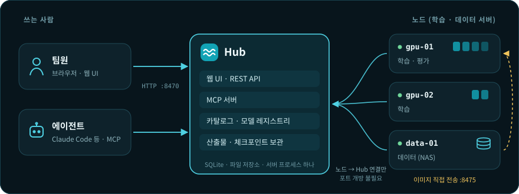
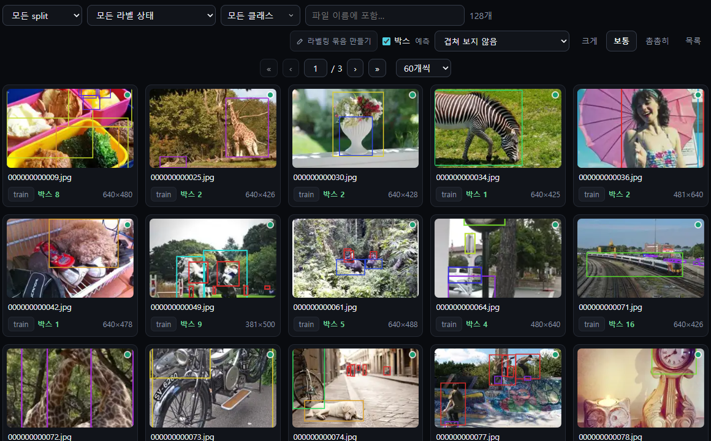
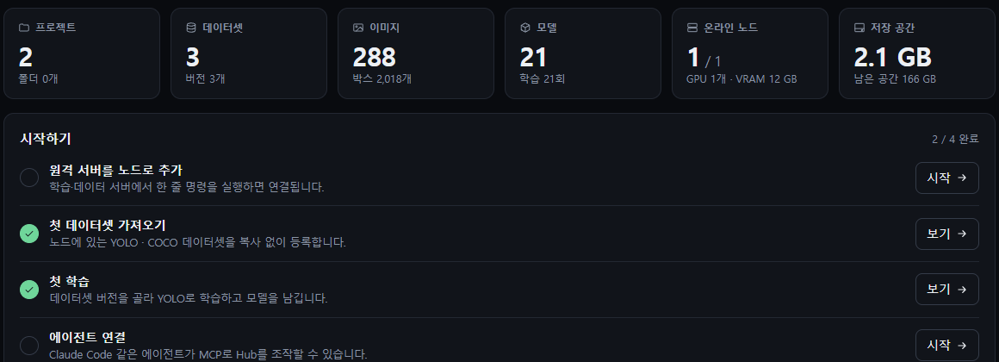

<p align="center">
  
</p>

<p align="center">
  <a href="https://github.com/RiceShrimp/BADAMOA/releases"></a>
  <a href="https://github.com/RiceShrimp/BADAMOA/actions/workflows/ci.yml"></a>
  
  
</p>

<p align="center">
  <b>한국어</b> · <a href="README.en.md">English</a>
</p>

<br>

**BADAMOA**는 사내 서버에 설치해 쓰는 비전 MLOps 플랫폼입니다. 이미지 데이터셋을 등록하고, 팀의 GPU 서버에서 학습하고, 나온 모델을 평가하고 관리하는 일을 웹 화면 하나에서 합니다. Docker나 별도 서버 프로그램 없이 Python 패키지 하나로 돌아갑니다.

이름은 "바다를 모아"에서 왔습니다. 흩어진 데이터의 바다를 모아 모델로 만든다는 뜻이고, 영문으로는 **B**uild · **A**nnotate · **D**evelop · **A**utomate와 **M**LOps **O**rchestration & **A**gents의 머리글자입니다.

<p align="center">
  
</p>

- **데이터는 제자리에 둡니다.** 학습 서버나 NAS에 있는 폴더를 고르면 목록과 라벨만 Hub에 모입니다. 수백 GB를 옮기지 않습니다.

- **GPU 서버는 명령 한 줄로 붙습니다.** 서버는 Hub로 나가는 연결만 쓰므로 방화벽에 구멍을 낼 필요가 없고, 남이 쓰고 있는 GPU는 피해서 배정합니다.

- **결과는 Hub에 남습니다.** 지표, 그림, 체크포인트, 가중치가 모두 Hub에 보관되어 학습 서버가 바뀌어도 이어서 학습하고 비교할 수 있습니다.

- **에이전트가 직접 다룹니다.** Hub가 MCP 서버를 겸하므로 Claude Code 같은 에이전트에게 학습을 맡기고 결과를 물어볼 수 있습니다.

<br>

## 구성

<p align="center">
  
</p>

Hub는 웹 화면, API, MCP 서버, 카탈로그와 모델 레지스트리를 한 프로세스에서 맡습니다. 실제 학습과 데이터 읽기는 노드가 합니다. Hub를 띄운 PC도 처음부터 노드 하나로 동작하므로, 서버가 한 대뿐이어도 바로 쓸 수 있습니다.

<br>

## 설치

### Hub 띄우기

[uv](https://docs.astral.sh/uv/)와 Node.js가 필요합니다. 저장소를 받은 폴더에서 차례로 실행합니다.

```bash
uv sync --all-extras
```

```bash
npm --prefix web install
```

```bash
npm --prefix web run build
```

```bash
uv run badamoa hub run --home .badamoa/hub
```

브라우저가 이 PC의 네트워크 주소(예: `http://192.168.0.10:8470`)로 열리면 관리자 계정을 만듭니다. 다른 서버는 이 주소로 Hub를 찾아오므로 `localhost` 대신 이 주소로 접속하세요.

> [!TIP]
> 시험해 볼 데이터는 `uv run python scripts/fetch_coco128.py`(COCO128, 약 7 MB)와 `uv run python scripts/fetch_mnist160.py`(MNIST160, 약 70 KB)로 받습니다. `.badamoa/data/` 아래에 풀립니다.

### 학습 · 데이터 서버 붙이기

웹 화면의 **노드 → 노드 추가**를 누르면 Ubuntu용과 Windows용 명령이 한 줄씩 나옵니다. 붙일 서버에서 그 명령을 실행하면(Ubuntu는 `sudo`, Windows는 관리자 PowerShell) 자동 시작으로 등록되고, 잠시 뒤 노드 화면에 나타납니다. 이후 업데이트는 Hub 버전을 따라 노드가 스스로 합니다.

노드끼리 이미지를 주고받을 때만 TCP 8475를 쓰며, 이 포트는 설치 명령이 방화벽에서 열어 둡니다.

<details>
<summary>Hub를 저장소가 아닌 곳에서 띄웠다면</summary>

<br>

저장소에서 `uv`로 Hub를 띄우면 노드가 받아 갈 설치 파일(wheel)을 Hub가 알아서 만듭니다. 그렇지 않으면 직접 만들어 올립니다.

```bash
uv build --wheel -o .badamoa/dist
```

```bash
uv run badamoa hub publish-wheel <wheel 파일> --home .badamoa/hub
```

</details>

### 에이전트 연결 (MCP)

**에이전트** 화면에서 토큰을 발급하면 연결 명령이 나옵니다.

```bash
claude mcp add --transport http badamoa http://192.168.0.10:8470/mcp --header "Authorization: Bearer <토큰>"
```

연결한 뒤 "노드 상태 점검해 줘", "coco128 v1으로 yolo11n 학습하고 끝나면 지표 알려 줘"처럼 말로 시키면 됩니다. 에이전트는 노드와 GPU 현황, 데이터셋과 버전, 학습 시작과 하이퍼파라미터 탐색, 모델 조회와 계보, alias 지정, 작업 로그와 실패 원인 진단까지 다룹니다.

<br>

## 둘러보기

아래는 모두 실제 화면입니다. COCO128과 MNIST160으로 학습해 둔 Hub에서 찍었습니다.

### 데이터셋

<p align="center">
  
</p>

YOLO, COCO, 클래스별 폴더 형식을 그대로 읽어 검출 · 분할 · 키포인트 · 분류 데이터셋으로 등록합니다. 가져올 때마다 버전이 생기고, 버전끼리의 차이를 볼 수 있습니다. 이미지는 split, 클래스, 라벨 상태로 걸러 봅니다. 틀린 박스나 클래스는 보던 화면에서 바로 고치고, 고친 것을 모아 새 버전으로 확정합니다. 이미 있는 버전은 바뀌지 않습니다.

### 학습과 하이퍼파라미터 탐색

<p align="center">
  
  
</p>

데이터셋 버전과 모델을 고르면 빈 GPU가 있는 노드에서 학습이 돌고, 지표 곡선과 epoch별 예측 그림이 실시간으로 올라옵니다. 실행끼리 곡선을 겹쳐 비교하고, 멈춘 학습은 체크포인트에서 이어 갑니다. 탐색은 모든 조합 · 무작위 · 베이지안(Optuna TPE)을 지원합니다.

### 모델

<p align="center">
  
</p>

학습이 끝나면 가중치가 모델 버전으로 등록됩니다. champion · production 같은 alias를 붙이고, 같은 데이터로 평가해 비교하고, ONNX · TorchScript로 내보내고, 이미지를 올려 바로 테스트합니다. 계보를 따라가면 그 모델이 어느 데이터와 설정에서 나왔는지 거꾸로 확인할 수 있습니다.

<p align="center">
  
</p>

### 서버와 Hub 상태

<p align="center">
  
  
</p>

노드 화면은 서버마다 GPU 칸과 CPU · 메모리 · 디스크를 한 판에 보여 줍니다. 사람이 직접 쓰고 있는 GPU는 사용 중으로 보고 작업을 보내지 않습니다. 홈에서는 데이터, 모델, 노드, 저장 공간을 숫자로 훑어봅니다.

<br>

## 지원하는 모델

| 작업 | 기본 제공 | 평가 · 내보내기 · 테스트 |
|---|---|---|
| 검출 | Ultralytics YOLO11 · YOLO26<br>torchvision Faster R-CNN · RetinaNet · FCOS · SSDlite | mAP, ONNX · TorchScript, 박스를 그린 이미지 |
| 분할 | Ultralytics YOLO11-seg · YOLO26-seg | mask mAP, ONNX, 마스크를 그린 이미지 |
| 분류 | torchvision ResNet · EfficientNet · MobileNetV3<br>ConvNeXt · RegNet · ViT · Swin | Top-1 · Top-5, 혼동 행렬, ONNX |
| 키포인트 | 가져오기와 보기만 (학습은 예정) | — |

노드가 처음 학습할 때 PyTorch와 학습 라이브러리를 노드 안의 별도 가상환경에 설치합니다(몇 분 걸림). GPU 드라이버에 맞는 빌드를 자동으로 고르고, 노드 환경 변수 `BADAMOA_TORCH_BACKEND`(예: `cpu`, `cu128`)로 지정할 수도 있습니다.

<br>

## 사내 학습 코드 등록하기

기본 제공 모델 말고 팀의 학습 코드를 쓰려면, 코드를 폴더 하나로 묶고 선언 파일(`badamoa.toml`)을 더해 **모델 템플릿**으로 올립니다. 그러면 학습 화면의 "모델 종류"에 나타나고, 기본 모델과 똑같이 학습 · 평가 · 내보내기를 할 수 있습니다.

<p align="center">
  
</p>

```bash
badamoa template init my-model
```

`my-model/train.py`의 표시한 부분을 자신의 코드로 바꿉니다. 설정 선언과 진행 보고는 SDK(`badamoa_sdk`)로 하며, W&B나 MLflow와 비슷하게 생겼습니다. BADAMOA가 코드를 실행할 때 SDK를 넣어 주므로 따로 설치하지 않습니다.

```python
import badamoa_sdk as bm

hp = bm.params(                                  # 설정 선언 → 학습 화면의 입력 칸
    model=bm.choice(["resnet18", "resnet50"], label="모델"),
    epochs=bm.integer(30, min=1, label="epoch"),
    lr=bm.number(0.001, label="학습률", group="최적화", advanced=True),   # "세부 설정"의 "최적화" 묶음
)
run = bm.init()                                  # run.data, run.out, run.device, run.classes …
for epoch in range(1, hp.epochs + 1):
    ...
    bm.log({"train_loss": loss, "map50_95": score}, step=epoch)       # 화면의 그래프에 바로 반영
    bm.progress(epoch, hp.epochs)
bm.log_artifact("confusion.png")                 # (선택) 그림·파일 → 실행 화면의 "파일"
bm.log_model(run.out / "best.pt")                # 모델로 등록할 가중치
bm.finish({"map50_95": best})
```

확인한 뒤 Hub에 올립니다.

```bash
badamoa template check my-model
```

```bash
badamoa template push my-model --hub http://<hub>:8470 --token <관리자 API 토큰>
```

필요한 패키지는 `badamoa.toml`의 `[environment] requirements`에 적으면 서버가 설치합니다. 서버에 이미 있는 conda · venv 환경을 쓰려면 **설정 → 환경**에 등록하고 그 이름을 `default`에 적습니다. 코드를 바꿔 다시 올릴 때는 `version`을 올리면 되고, 각 학습은 자기가 쓴 버전을 기억하므로 "다시 실행"은 같은 코드로 돕니다.

<br>

## 현재 상태

0.x 개발 버전입니다. 무엇이 되고 무엇이 남았는지는 아래와 같고, 자세한 순서는 [로드맵](docs/ROADMAP.md)에 있습니다.

| 영역 | 되는 것 | 남은 것 |
|---|---|---|
| **Build** · 데이터 | ✅ 복사 없는 등록, 버전과 라벨 개정, 버전 비교, 노드 간 직접 전송 | 🚧 샘플 라이브러리, 임베딩 검색, 큐레이션 |
| **Annotate** · 라벨 | ✅ 박스 · 윤곽 · 키포인트 보기, 그 자리에서 라벨 고치기와 새 버전 확정 | 🚧 윤곽 · 키포인트 모양 고치기, 오토라벨, 검수 |
| **Develop** · 학습 | ✅ 학습, 탐색, 평가, 내보내기, 모델 레지스트리, 사내 템플릿 | 🚧 TensorRT, 키포인트 학습 |
| **Automate** · 배포 | — | 🚧 추론 서비스, 배포, 파이프라인 |
| **MOA** · 운영 | ✅ 노드와 GPU 배정, 자동 업데이트, MCP 에이전트 | 🚧 승인 게이트, 내장 에이전트 |

> [!NOTE]
> 지금은 HTTP로만 동작하니(TLS는 예정) 사내망 안에서 쓰세요. 노드마다 PyTorch가 든 가상환경을 만들어 수 GB를 차지합니다. 확인은 COCO128 · MNIST160 같은 작은 데이터로 했고, 큰 데이터에서의 속도는 실제로 올릴 때 잽니다.

<br>

## 개발

```bash
uv run pytest
```

```bash
uv run ruff check .
```

웹 화면을 고칠 때는 Hub를 띄운 채로 `npm --prefix web run dev`를 실행하면 `/api` 요청이 Hub로 넘어갑니다. COCO128을 받아 두면 `uv run pytest`가 실데이터 확인도 함께 하고, `BADAMOA_TEST_YOLO=1`을 붙이면 실제 YOLO 학습(1 epoch, CPU)까지 확인합니다.

```
src/badamoa/core       공용 스키마 · storage · 시스템 정보
src/badamoa/hub        Hub: REST · 노드 프로토콜 · MCP · 웹 화면 제공
src/badamoa/node       Node Agent · 데이터 가져오기 · 학습용 변환 · 환경 · 노드 간 전송
src/badamoa/templates  기본 모델 템플릿 · SDK(badamoa_sdk) · 새 템플릿의 뼈대
web/                   웹 화면 (React + Vite)
tests/                 단위 · API · E2E
```

새 버전은 `src/badamoa/__init__.py`의 버전과 [CHANGELOG.md](CHANGELOG.md)를 함께 올려 main에 푸시하면 됩니다. 같은 내용의 릴리즈가 [GitHub Releases](https://github.com/RiceShrimp/BADAMOA/releases)에 자동으로 만들어집니다.

### 문서

- [CHANGELOG.md](CHANGELOG.md) — 버전별 변경 (앱 안의 릴리즈 노트와 같은 내용)
- [docs/ARCHITECTURE.md](docs/ARCHITECTURE.md) — 목표, 설계 원칙, 구조
- [docs/ROADMAP.md](docs/ROADMAP.md) — 단계별 계획과 체크리스트
- [docs/EXECUTION_PLAN.md](docs/EXECUTION_PLAN.md) — 사내 학습 코드 · 환경 · 저장 위치, MLflow · W&B 대조표
- [docs/LABELING_PLAN.md](docs/LABELING_PLAN.md) — 라벨 고치기와 라벨링 계획
- [docs/SCREEN_SPECS.md](docs/SCREEN_SPECS.md) — 화면 구성
- [docs/REFERENCE_STUDY.md](docs/REFERENCE_STUDY.md) · [docs/PLANS.md](docs/PLANS.md) — 참고 제품 분석, 최초 구상
